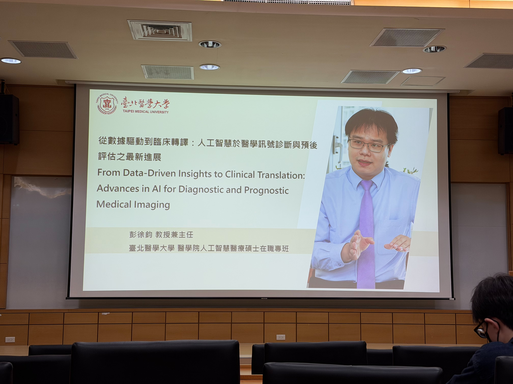

# **從數據驅動到臨床轉譯：人工智慧於醫學訊號診斷與預後評估之最新進展 From Data-Driven Insights to Clinical Translation: Advances in AI for Diagnostic and Prognostic Medical Imaging**

> **演講者**：彭徐鈞 教授兼主任 台北醫學大學 醫學院人工智慧醫療碩士在職專班
> **演講日期**：2026/09/22

本次內容主要介紹 **Artificial Intelligence（AI）在醫療領域中的應用**，包含神經外科、眼科、兒童腦瘤與精神醫學等研究案例。彭主任也特別提到：醫療 AI 的核心目的並不是取代醫師，而是透過人工智慧分析大量的 **醫療影像、臨床資料與生理訊號**，協助醫師進行疾病診斷、預後預測與治療決策，而一個重要概念是：

> **人工智慧是一項輔助工具，最終的醫療決策仍需要由臨床醫師負責。**



## 壹、AI 在醫療應用中的核心價值

AI 在醫療領域主要具有兩個重要功能：

* **Prediction（預測）**：根據病人的影像、訊號與臨床資料，預測某種治療方式是否適合特定病人，以及治療後可能產生的預後。
* **Diagnosis Aid（診斷輔助）**：利用人工智慧協助醫師判讀醫療影像或生理訊號，提高疾病診斷的效率與一致性。

例如，在治療前可以利用 AI 回答：

> **這個病人接受治療之後，疾病是否可能改善？**

或是：

> **這個病人的影像是否具有某種疾病特徵？**

因此 AI 的角色比較接近 **Clinical Decision Support（臨床決策支援）**，而不是完全自動取代醫師。

## 貳、醫療 AI 的模型開發流程

醫療 AI 的建立通常包含以下幾個主要步驟：

```text
Data Collection
      ↓
Data Preprocessing
      ↓
Feature Engineering
      ↓
Feature Selection
      ↓
Model Training
      ↓
Model Validation
      ↓
Explainable AI
      ↓
External Validation
      ↓
Clinical Deployment
```

### 一、Data Collection（資料蒐集）

醫療 AI 研究通常需要投入大量時間進行資料蒐集。 常見資料來源包含：

* MRI
* CT
* OCT
* EEG
* 臨床資料
* 生理訊號
* 病理報告

AI 模型的效能高度依賴資料，因此：

> **高品質資料往往比單純使用更複雜的 AI 模型更加重要。**

許多醫療 AI 研究能夠進行，也仰賴醫院與前輩長時間累積的大量臨床資料。

### 二、Data Preprocessing（資料前處理）

取得資料後，需要先進行資料清理與標準化，例如：

* 處理 **Missing Data（缺失資料）**
* 移除錯誤或品質不佳的資料
* Min-Max Normalization
* 影像裁切
* 灰階強度調整
* 訊號濾波
* ROI（Region of Interest）擷取

其中另一個常見問題是： **Class Imbalance（類別不平衡）** 例如：

| 類別 | 病例數 |
| -- | --: |
| A  | 100 |
| B  | 100 |
| C  |  10 |

此時模型可能傾向預測病例數較多的類別。 早期可能使用 **SMOTE（Synthetic Minority Over-sampling Technique）** 建立人工樣本進行過度採樣，但人工產生的新資料可能改變原始資料分佈，使不同實驗之間產生不一致的結果。 因此另一種作法是使用：

* **Class Weight**
* **Sample Weight**

給予少數類別較高的訓練權重，而不直接修改原始資料分佈。

### 三、Feature Engineering（特徵工程）

根據不同資料形式，可以提取不同類型的特徵。 **醫療影像：**

* Shape（形狀）
* Intensity（灰階強度）
* Texture（紋理）
* Location（位置）

**生理訊號：**

* Time Domain（時域）
* Frequency Domain（頻域）
* Time-Frequency Domain（時頻域）
* Functional Connectivity（功能性連結）

一張醫療影像可能產生數百甚至上千個特徵，因此通常還需要進一步進行 **Feature Selection（特徵篩選）**。

### 四、Feature Selection（特徵篩選）

常見的特徵篩選方法包含：

* 移除變異數過小的特徵
* 移除高度相關的特徵，避免共線性
* MRMR（Maximum Relevance Minimum Redundancy）
* Lasso

其中最重要的原則之一是：

> **特徵篩選只能使用 Training Set，不可以使用 Independent Test Set。**

如果在挑選特徵時偷看測試資料，就會產生： **Data Leakage（資料洩漏）** 這會造成模型在實驗中表現異常良好，但實際部署到新的病人資料時，效能可能大幅下降。

### 五、Model Training & Validation（模型訓練與驗證）

醫療 AI 研究通常不會只建立一個模型，而是同時測試多個模型，例如：

* Logistic Regression
* Support Vector Machine
* Random Forest
* Neural Network
* CNN
* ResNet
* VGG

再比較不同模型的表現。 模型訓練過程中常使用：**Cross-validation（交叉驗證）**，例如：**5-fold Cross-validation**，也就是將訓練資料分成五份，每次使用其中一份進行驗證，其餘四份進行訓練。 如果資料量非常少，也可以使用：**Leave-One-Out Cross-Validation（LOOCV）**：每次留下 1 筆資料進行測試，其餘資料作為訓練資料。

### 六、Independent Test Set（獨立測試集）

醫療 AI 研究中特別重視 **Independent Test Set**。 測試資料不能參與：

* 特徵篩選
* 超參數調整
* 模型選擇
* 資料增強

若模型甚至可以使用另一間醫院的資料進行驗證，則稱為： **External Validation（外部驗證）** 這可以進一步評估模型在不同醫院、設備與病人族群上的： **Generalization Ability（泛化能力）**

## 參、Explainable AI（可解釋性人工智慧）

醫療 AI 不只需要準確，也需要知道：

> **為什麼模型會做出這個判斷？**

如果模型只是輸出：

```text
Cancer Probability = 92%
```

但完全無法說明判斷依據，臨床醫師通常很難完全信任模型。 因此醫療 AI 特別重視： **Explainable AI（XAI）** 常見方法包含：

* **SHAP（SHapley Additive exPlanations）**：分析不同臨床特徵對模型預測結果的貢獻程度。
* **Grad-CAM / Heatmap**：觀察 CNN 在醫療影像中主要關注哪些區域。

例如模型判斷黃斑部疾病時，如果 AI 關注的位置與眼科醫師平常判讀的黃斑部中央區域一致，就可以增加模型結果的可信度。 因此：

> **模型效能相近時，醫師通常會更加信任判斷依據符合臨床知識的模型。**

## 肆、醫療 AI 的臨床應用挑戰

醫療 AI 與一般 AI 應用最大的差異之一，就是：**模型錯誤可能直接影響病人的生命與健康。** 因此醫療 AI 必須特別重視：

* 資料品質
* 模型驗證
* 外部驗證
* 資料洩漏
* 可解釋性
* 臨床合理性
* 泛化能力
* 使用者介面
* 法規認證

真正進入臨床應用之前，也可能需要經過：

* **TFDA（台灣食品藥物管理署）**
* **FDA（美國食品藥物管理局）**

等相關醫療器材與軟體規範的驗證。

---

# 伍、聽神經瘤的 AI 預後預測

## 一、疾病背景

**Acoustic Neuroma（聽神經瘤）** 通常屬於良性腫瘤，大多數病人在適當治療後具有良好的預後。 然而部分患者接受治療後，腫瘤並不會立即縮小，而可能出現：

```text
腫瘤變大
   ↓
維持一段時間
   ↓
之後縮小
```

這種情況稱為： **Delayed Progression（延遲進展 / 假性進展）** 因此，如果治療後只看到腫瘤短暫變大，並不能立即判定治療失敗。 當腫瘤體積持續增加時，可能逐漸壓迫：

* 腦幹
* 小腦
* 周圍神經組織

進而產生眩暈、神經功能異常甚至癱瘓等症狀。

## 二、研究目標

研究主要包含兩個部分：

### Automatic Segmentation

利用 MRI 自動分割：

* 聽神經瘤
* 小腦
* 腦幹

### Prognosis Classification

根據治療後腫瘤體積的變化，將患者分成四種類型：

1. **Failure**：腫瘤持續增大
2. **Stable**：體積變化維持於 $\pm15%$
3. **Direct Shrinkage**：腫瘤直接縮小
4. **Delayed Progression**：先變大，之後再縮小

## 三、資料與研究方法

資料主要來自 **台北榮總** 的歷史病例資料。 研究包含：

* 總訓練資料約 579 筆
* 長期追蹤病例約 155 例
* 外部測試資料約 173 例

主要影像模態為： **MRI（Magnetic Resonance Imaging）** 其中 155 個長期病例的類別分布為：

| 預後類型                | 病例數 |
| ------------------- | --: |
| Failure             |   9 |
| Stable              |  19 |
| Direct Shrinkage    |  53 |
| Delayed Progression |  74 |

可以發現不同類別之間具有明顯的 **Class Imbalance**。 因此模型訓練時使用： **Class Weight** 提高少數類別在 Loss Function 中的影響程度。

## 四、自動腫瘤分割

研究使用：**U-Net**，進行 MRI 腫瘤自動分割，模型訓練時間約：**30 天** 評估主要使用： **Dice Score（DICE）** Dice Score 用來衡量：

> **AI 分割結果與醫師標註區域之間的重疊程度。**

模型的 Dice Score 約可達：

$$
91\%-92\%
$$

研究結果已接近國際頂尖表現。

## 五、臨床意義

AI 可以協助醫師：

* 自動計算腫瘤體積
* 分析腫瘤變化
* 判斷治療是否失敗
* 辨別 Delayed Progression
* 提供長期預後資訊

但即使模型準確度很高，也仍然只能作為： **Clinical Decision Support Tool** 因為最終醫療決策仍必須由醫師進行判斷。

---

# 陸、黃斑部手術後視力恢復預測

## 一、臨床問題

黃斑部疾病患者接受手術之後，視力通常會逐漸恢復，但最大的問題是：

> **手術前很難知道患者術後視力究竟可以恢復多少。**

例如：

```text
0.2？
0.4？
0.8？
1.0？
```

此外：**手術成功並不等於視力恢復良好**，因此即使眼科醫師認為手術執行得非常成功，病人的視力仍有可能恢復不佳。

## 二、研究目標

研究希望利用： **OCT（Optical Coherence Tomography，光學相干斷層掃描）** 預測病人在黃斑部手術後的視力恢復情形。

## 三、研究資料

資料來自： **台北市立聯合醫院兩個不同分院** 原始資料包含：

* 1773 位病人
* 1839 隻眼睛

經過排除條件後剩下：

* 653 位病人
* 660 隻眼睛

其中：

* 644 隻眼睛：Training / Validation
* 29 隻眼睛：External Test

病人至少追蹤： **1 年** 以確保術後視力已經有足夠時間恢復。

## 四、排除條件

為降低其他疾病對預測結果的影響，研究排除：

* 糖尿病視網膜病變
* 白內障手術史
* 眼內注射史
* OCT 影像品質不佳
* 其他可能影響視力的眼科疾病

## 五、影像前處理

原始 OCT 影像會先進行： **ROI（Region of Interest）擷取** 主要選取：

* RPE（Retinal Pigment Epithelium）
* RNFL（Retinal Nerve Fiber Layer）

附近區域。 移除大量無關區域之後，模型可以更集中分析真正具有臨床意義的位置，研究中也發現 ROI 前處理可以明顯提升模型表現。 此外使用： **Data Augmentation** 增加模型訓練資料。 但需要注意：

> **Data Augmentation 只能使用於 Training Set。**

## 六、模型訓練

研究使用： **Transfer Learning（遷移學習）** 模型包含：

* ResNet-101
* VGG-19

原先可以將術後視力視為： **Regression Problem** 直接預測：

$$
0.1,\ 0.2,\ 0.5,\ 1.0
$$

但經過與臨床醫師討論後，研究將問題轉換為： **Binary Classification** 以術後視力：

$$
0.2
$$

作為臨床判斷閾值：

* **> 0.2**：有效
* **≤ 0.2**：效果不佳

## 七、研究結果

ResNet-101 與 VGG-19 的：

$$
AUC \approx 0.90
$$

外部測試資料中：

$$
Recall \approx 0.93
$$

$$
F1\text{-Score} \approx 0.93
$$

## 八、Explainable AI

研究進一步利用 Heatmap 分析模型判斷的位置。 其中： **ResNet-101** 主要關注於： **黃斑部中央附近** 與臨床眼科醫師平常觀察的位置較為一致。 相比之下，VGG-19 有部分注意力落在影像邊緣。 即使兩個模型的 Accuracy 相近：

> **臨床醫師通常會更相信判斷位置符合醫學知識的模型。**

## 九、臨床應用

對一般眼科醫師而言，可以利用 AI 判斷：

> **患者是否需要轉診至視網膜專科。**

對視網膜專科醫師而言，AI 可以協助：

* 評估是否適合立即手術
* 預測術後視力
* 評估是否可以同時進行白內障與黃斑部手術

例如患者同時具有：

```text
白內障
+
黃斑部疾病
```

如果 AI 預測黃斑部手術預後良好，可以考慮同時治療。 若黃斑部預後較差，則可能考慮採用分階段治療。

---

# 柒、小兒低惡性度膠質瘤與術後癲癇預測

## 一、疾病背景

**Low-Grade Glioma（低惡性度膠質瘤）** 是兒童常見的腦部腫瘤之一。 部分兒童接受腫瘤手術後可能產生： **Epilepsy（癲癇）** 但在手術之前很難準確判斷：

> **哪些小朋友之後可能發生癲癇？**

目前已知： **腫瘤位置** 與癲癇風險具有關係，例如： **Temporal Lobe（顳葉）** 就是其中一個重要區域。

## 二、研究目標

研究希望結合：

```text
Tumor Location
      +
Radiomics Features
      ↓
AI Model
      ↓
Seizure Prediction
```

預測兒童低惡性度膠質瘤患者是否可能發生癲癇。

## 三、研究資料

研究資料量非常小： **約 23 例** 使用的影像為： **T2-FLAIR MRI** 主要原因是過去研究指出 T2-FLAIR 對癲癇相關腦部變化較為敏感。

## 四、腫瘤 ROI 標註

醫療影像研究中的 ROI 必須具有高度可信度。 因此研究首先使用： **Pathology Report（病理報告）** 作為 Gold Standard。 如果沒有病理報告，則由： **三位資深臨床醫師** 分別進行標註，再取得共識區域作為最終 ROI。

## 五、影像特徵

研究從腫瘤 ROI 中取得約： **200 多個 Radiomics Features** 主要包含：

* **Shape**：腫瘤形狀
* **Intensity**：灰階強度分布
* **Texture**：腫瘤內部紋理
* **Location**：腫瘤位置

### Tumor Location

研究將腫瘤影像轉換至： **Standard Brain Atlas（標準腦圖譜）** 之後計算腫瘤位於不同腦區的比例，例如：

* Frontal Lobe
* Temporal Lobe
* Parietal Lobe
* Occipital Lobe
* Midbrain

這使原本「腫瘤在哪裡」這種文字描述，可以轉換成數值化特徵。

## 六、Feature Selection

由於資料只有約 23 例，但特徵超過 200 個，因此：

$$
Features \gg Samples
$$

很容易發生： **Overfitting（過擬合）** 因此必須進行 Feature Selection，例如使用： **MRMR** 挑選真正具有預測能力的少量特徵。

## 七、研究結果

如果只使用： **Tumor Location** 模型結果約為：

$$
AUC \approx 0.87
$$

$$
Accuracy \approx 0.79
$$

如果只使用： **Radiomics Features** 則：

$$
AUC \approx 0.85
$$

但如果將：

```text
Tumor Location
      +
Radiomics Features
```

結合之後：

$$
AUC > 0.95
$$

其中較重要的位置包含：

* **Temporal Lobe**
* **Midbrain**

這些結果與過去臨床研究具有一定一致性。

## 八、臨床意義

如果能夠在治療前判斷：

> **哪些兒童具有較高的癲癇風險？**

醫師便可以提早進行：

* 癲癇監測
* 預防性藥物治療
* 更密集的術後追蹤

例如可能針對： **Sodium Channel（鈉離子通道）** 相關機制進行預防性治療。

---

# 捌、重度憂鬱症長期療效預測

## 一、疾病背景

**Major Depressive Disorder（MDD，重度憂鬱症）** 不僅影響病人本身，也會對家庭與社會造成很大的醫療與經濟負擔。 目前精神科治療常採用： **Try and Error（試誤法）** 例如：

```text
選擇藥物
   ↓
治療約 4 週
   ↓
患者回診
   ↓
評估療效
   ↓
效果不好 → 換藥或調整劑量
```

問題是：

> **醫師在治療開始之前，很難知道哪一種治療對病人有效。**

## 二、為什麼不直接使用 fMRI？

**fMRI（Functional Magnetic Resonance Imaging）** 可以觀察 Functional Brain Network，但臨床上存在：

* 檢查成本較高
* 排程困難
* 設備較大型
* 不容易頻繁檢查

等問題。 因此研究選擇： **EEG（Electroencephalography，腦電波）** 作為較容易應用於臨床的生理訊號。

## 三、研究目標

研究利用：

```text
EEG
+
少量 Clinical Variables
      ↓
Machine Learning
      ↓
Treatment Response Prediction
```

預測患者治療：

* 4 週
* 6 週
* 8 週

之後的療效。

## 四、研究資料

研究共有： **77 位重度憂鬱症患者** EEG 在：

* 治療前
* 治療後第 1 週

進行量測。 EEG 使用： **19 個電極** 每次量測時間約： **2 分鐘** 病人在：

* Week 4
* Week 6
* Week 8

進行： **HDRS（Hamilton Depression Rating Scale）** 評估。

## 五、Responder 定義

如果 HDRS 相較治療前下降：

$$
\geq 50\%
$$

則定義為： **Responder** 否則為： **Non-Responder** 因此最終形成： **Binary Classification Problem**

## 六、EEG 前處理

EEG 訊號首先進行：

### Frequency Filtering

保留：

$$
0.5-30Hz
$$

### Referencing

降低各個 EEG 電極之間共有的訊號成分。

### ICA

使用： **Independent Component Analysis（ICA）** 將 EEG 分解成不同訊號來源。 主要希望去除：

* Eye Movement
* Heartbeat
* EMG
* Power-line Noise
* Movement Artifact

最後盡可能保留真正來自： **Brain Activity** 的訊號。

## 七、EEG 特徵

研究主要包含兩種特徵。

### Power Features

計算不同 EEG Channel 在不同 Frequency Band 的能量，例如：

* Delta
* Theta
* Alpha
* Beta

### Functional Brain Network

分析不同 EEG 電極之間的功能性連結。 例如：

* PLV（Phase Locking Value）
* PLI（Phase Lag Index）
* wPLI（Weighted Phase Lag Index）

簡單來說，就是分析：

> **不同腦區的腦波活動彼此之間是否同步。**

進而建立： **Functional Brain Network（功能性大腦網路）**

## 八、模型訓練

由於只有： **77 位患者** 研究使用： **Leave-One-Out Cross-Validation** 每次：

```text
76 位 → Training
1 位  → Testing
```

重複： **77 次** 使每一位患者都曾經作為一次測試資料。 研究總共比較： **19 個模型**

## 九、研究結果

如果單純依靠臨床經驗猜測療效，表現大約接近：

$$
AUC \approx 0.50
$$

加入 EEG 與 AI 分析後，可提升至：

$$
AUC \approx 0.70-0.80
$$

雖然這樣的數值不像某些影像 AI 模型可以達到 0.9 以上，但在精神醫學領域：

> **能將原本接近隨機判斷的預測能力提升至 70%-80%，已具有相當大的臨床意義。**

## 十、臨床應用

AI 可以協助精神科醫師：

* 預測患者是否可能對治療有效
* 提早更換治療方案
* 避免患者浪費數週進行無效治療
* 協助辨識高風險病人

未來甚至可能應用於： **Suicide Prevention（自殺防治）** 利用 EEG 找出可能具有較高風險的患者，進行早期介入。

## 十一、未來研究方向

EEG 可以視為一個： **Graph（圖）** 其中：

```text
Node = EEG Electrode / Brain Region
Edge = Functional Connectivity
```

因此未來除了傳統 Machine Learning，也可以使用：

* **CNN**
* **Graph Neural Network（GNN）**

進一步分析大腦功能性網路。

---

# 玖、其他醫療 AI 研究方向

## Gamma Knife 與放射治療

**Gamma Knife（伽馬刀）** 在台灣已經具有二十多年發展歷史，主要應用於治療：

* 腦瘤
* 轉移性腦瘤
* 血管瘤
* 聽神經瘤

等疾病。 與傳統開顱手術相比，部分疾病使用 Gamma Knife 可以減少侵入性並改善治療結果。 而前述： **Acoustic Neuroma 預後預測** 就是利用長期累積的 Gamma Knife 病例資料，進一步發展人工智慧模型的案例之一。

---

# 拾、醫療 AI 研究的共同架構

綜合上述幾個案例，可以發現醫療 AI 研究大多遵循相似流程：

```text
Clinical Problem
臨床痛點
      ↓
Data Collection
資料蒐集
      ↓
Data Preprocessing
資料前處理
      ↓
ROI / Feature Extraction
感興趣區域與特徵擷取
      ↓
Feature Selection
特徵篩選
      ↓
Model Training
模型訓練
      ↓
Cross-validation
交叉驗證
      ↓
Independent / External Test
獨立或外部測試
      ↓
Explainable AI
模型可解釋性
      ↓
Clinical Validation
臨床驗證
      ↓
Clinical Deployment
臨床應用
```

不同研究最大的差異主要在於：

| 研究        | 輸入資料         | 預測目標      |
| --------- | ------------ | --------- |
| 聽神經瘤      | MRI          | 腫瘤分割與治療預後 |
| 黃斑部疾病     | OCT          | 術後視力恢復    |
| 小兒低惡性度膠質瘤 | T2-FLAIR MRI | 癲癇風險      |
| 重度憂鬱症     | EEG          | 長期治療療效    |

雖然不同研究使用的資料與疾病不同，但核心概念都是：

> **從臨床問題出發，透過醫療資料建立 AI 模型，再以嚴謹的驗證方式確認模型是否具有臨床價值。**

# 拾壹、研究中的重要觀念

綜合所有案例，可以整理出幾個醫療 AI 特別重要的原則。

### 1. Data Quality > Model Complexity

資料品質往往比模型是否足夠複雜更加重要。 如果原始資料本身存在：

* 錯誤
* 偏差
* 標註不一致
* 樣本不足

即使使用非常複雜的深度學習模型，也不一定能得到具有臨床價值的結果。

### 2. Independent Test Set 不能被偷看

Testing Data 必須保持真正獨立。 特別是在：

* Feature Selection
* Hyperparameter Tuning
* Data Augmentation
* Model Selection

過程中都不應使用 Testing Data。 否則容易產生： **Data Leakage** 導致模型效能被高估。

### 3. Class Imbalance 不能只看 Accuracy

當病例分布不平均時，單純使用 Accuracy 很可能產生誤導。 因此醫療 AI 常搭配：

* Recall
* Precision
* F1-Score
* AUC
* Dice Score

等評估方式。

### 4. Explainability 非常重要

醫療 AI 不只是：

> **預測對不對？**

還必須進一步回答：

> **為什麼做出這個預測？**

如果 AI 找出的重要特徵與醫學知識一致，會大幅增加模型的可信度。

### 5. External Validation 決定模型能不能真正使用

模型在自己的醫院表現很好，並不代表：

> **到了另外一家醫院仍然有效。**

不同醫院可能使用不同：

* MRI
* OCT
* EEG
* 掃描參數
* 病人族群
* 資料格式

因此 External Validation 是判斷 AI 是否具有真正臨床應用價值的重要步驟。

### 6. AI 最終仍是輔助工具

即使模型具有：

$$
90\%+
$$

的準確度，也不代表可以完全取代醫師。 醫療 AI 最適合的角色仍然是： **Clinical Decision Support System** 也就是：

```text
AI 提供資訊
      ↓
醫師結合臨床經驗
      ↓
進行最終判斷
```

因此醫療 AI 最重要的目的並不是取代醫師，而是：

> **讓醫師能夠利用更多客觀資料，在有限時間內做出更有依據的臨床決策。**

## 拾貳、心得
在這次演講中，我印象最深刻的是「資料品質比模型複雜度更重要」這個觀念。即使使用很先進的神經網路，如果原始資料存在錯誤、樣本不足或類別不平衡，最後得到的模型仍可能缺乏實際價值。另外，Independent Test Set 與 External Validation 也非常重要，如果在特徵選擇或模型調整時使用到測試資料，就可能造成 Data Leakage，使模型的效能看起來很好，但實際面對新的病人資料時卻無法維持相同表現。

另外就是聽神經瘤、黃斑部疾病、小兒低惡性度膠質瘤以及重度憂鬱症等案例，也讓我看到人工智慧可以處理 MRI、OCT、EEG 等不同型態的醫療資料，尤其 Explainable AI 的概念讓我印象很深，醫療模型不只需要告訴醫師預測結果，還需要進一步說明模型為什麼做出這個判斷。

經過這次的演講，我了解到醫療 AI 的目的並不是取代醫師，而是成為臨床決策支援工具。真正有價值的 AI，不只是追求更高的準確率，而是必須兼顧資料品質、模型可信度、可解釋性以及實際臨床需求，才能真正對醫療工作產生幫助。

## 拾參、關鍵字
- **Diagnosis Aid（診斷輔助）**
- **Transfer Learning（遷移學習）**
- **U-Net**
- **Clinical Decision Support（臨床決策支援）**
- **Independent Test Set**
- **LOOCV（Leave-One-Out Cross-Validation）**
- **Explainable AI**
- **ROI（Region of Interest，感興趣區域）**

## 拾肆、參考文獻
- Huang, C. Y., Peng, S. J., et al. (2022). Quantification of tumor response of cystic vestibular schwannoma to Gamma Knife radiosurgery by using artificial intelligence. Journal of Neurosurgery, 136(5), 1298–1306.
- Huang, C. Y., Peng, S. J., Yang, H. C., et al. (2023). Association Between Pseudoprogression of Vestibular Schwannoma After Radiosurgery and Radiological Features of Solid and Cystic Components. Neurosurgery, 93(6), 1383–1392.
- Lin, H. L. E., Tseng, P. C., Hsu, M. H., & Peng, S. J. (2025). Using a Deep Learning Model to Predict Postoperative Visual Outcomes of Idiopathic Epiretinal Membrane Surgery. American Journal of Ophthalmology, 272, 67–78.
- Tsai, M. L., Hsieh, K. L. C., Liu, Y. L., et al., & Peng, S. J. (2025). Morphometric and radiomics analysis toward the prediction of epilepsy associated with supratentorial low-grade glioma in children. Cancer Imaging, 25, 63.
- Huang, S. S., Huang, H. L., Lin, T. P., Kuo, P. H., Hou, P. H., & Peng, S. J. (2025). Predicting the longitudinal efficacy of medication for depression using electroencephalography and machine learning. Journal of Psychiatric Research, 190, 372–379.