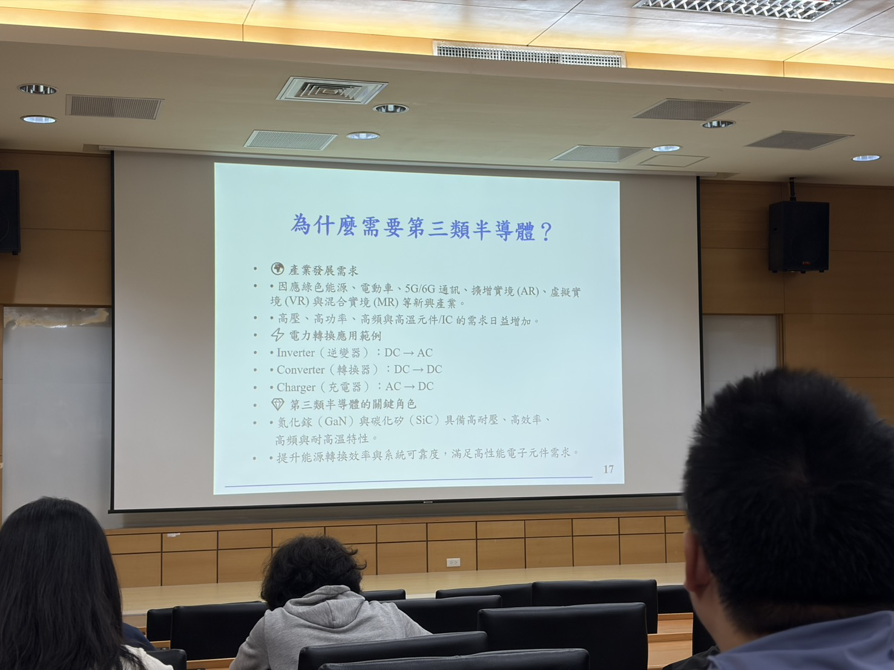

# **第三類半導體之關鍵技術與元件應用**

> 演講者：國立聯合大學電機系 楊智強博士
>
> 演講日期：2026/11/24

楊教授本次演講主要介紹第三類半導體的材料特性、發展背景及元件應用，從國家淨零碳排政策與電動車發展趨勢切入，說明第三類半導體在能源轉換及高功率電子元件中的重要性。

此外，楊教授還透過比較第一類、第二類及第三類半導體的材料特性，進一步探討氮化鎵（GaN）與碳化矽（SiC）在電動車、再生能源、快速充電及高頻通訊等領域的應用，並說明材料選擇、元件效能與製造成本之間的關係。

## **壹、研究背景與能源發展趨勢**

隨著全球淨零碳排政策的推動，電動車、再生能源及高效率電力轉換系統逐漸受到重視，傳統矽半導體在高壓、高頻及高功率的應用中具有一定限制，因此第三類半導體成為重要的研究與發展方向。

1\. 國家能源政策與發展目標：

- 淨零碳排：臺灣以 2050 年達成淨零碳排為目標，推動能源、產業、生活及社會等方面的轉型。
- 電動車普及：政府規劃於 2040 年達成新售汽機車全面電動化的目標。
- 再生能源發展：透過太陽能、風力及其他再生能源，逐步改善能源結構。
- 能源效率提升：透過低功耗電子元件及高效率電力轉換設備，減少能源消耗。

2\. 第三類半導體的重要性：

- 耐高壓：適合電動車及高壓電力轉換系統。
- 高頻操作：可提升電子元件的切換速度，並應用於高頻通訊。
- 高功率：能滿足電動車、工業設備及大型電力系統的需求。
- 高轉換效率：降低電力轉換過程中的能源損耗，提升系統整體效率。

## **貳、三類半導體的材料特性與應用**

教授特別說明，臺灣較常使用「第一類、第二類及第三類半導體」的稱呼，而非以「代」區分，主要是因為不同類別的半導體具有各自適合的應用領域，並非新一類半導體出現後，就會完全取代原有的材料。

1\. 第一類半導體：

- 代表材料：矽（Si）、鍺（Ge）。
- 材料特性：屬於元素半導體，製造技術成熟且成本相對較低。
- 應用領域：邏輯晶片、記憶體、類比晶片及微處理器等。
- 主要優勢：適合一般電子產品及成本導向的應用。

2\. 第二類半導體：

- 代表材料：砷化鎵（GaAs）、磷化銦（InP）。
- 材料特性：屬於化合物半導體，具有良好的高速電子元件及光電應用特性。
- 應用領域：射頻通訊、紅外線元件、雷射、光纖通訊及 3D 感測等。

3\. 第三類半導體：

- 代表材料：氮化鎵（GaN）、碳化矽（SiC）。
- 材料特性：屬於寬能隙（Wide Bandgap, WBG）半導體，具有較高的崩潰電場，適合高壓、高頻及高功率應用。
- 應用領域：電動車、快速充電器、再生能源、功率轉換器及 5G、6G 通訊等。

## **參、氮化鎵與碳化矽的特性及應用**

氮化鎵與碳化矽是目前第三類半導體中具有代表性的材料，雖然兩者皆具有寬能隙及耐高壓等特性，但在操作頻率、耐壓能力、散熱特性及製造成本方面仍存在差異，因此適合的應用領域也有所不同。

1\. 氮化鎵（Gallium Nitride, GaN）：

- 開關速度快：適合高頻操作的電子元件及電力轉換系統。
- 降低能源損耗：減少切換過程中的能量損失，提升電力轉換效率。
- 元件小型化：透過高頻操作縮小電源轉換系統的體積。
- 應用案例：手機快速充電器、輕薄型筆記型電腦電源供應器、射頻功率放大器及基地臺等。

2\. 碳化矽（Silicon Carbide, SiC）：

- 耐高壓能力佳：適合高電壓及大功率的電力轉換系統。
- 熱傳導能力佳：有利於高功率元件的散熱及高溫環境下的操作。
- 降低電力損耗：相較於傳統矽功率元件，可改善高功率應用中的能源轉換效率。
- 應用案例：電動車馬達驅動系統、太陽能逆變器、軌道運輸及工業電力設備等。

3\. 兩種材料的選擇與成本考量：

- 耐壓差異：教授以常見的市售 650 V 氮化鎵元件，以及 1,000～1,200 V 等級的碳化矽元件為例，說明兩者在耐壓能力上的差異。
- 製造成本：碳化矽元件的成本相對較高，可能進一步影響電動車等終端產品的售價。
- 研究方向：提升氮化鎵元件的耐壓能力，使其有機會取代部分原先使用碳化矽的應用，進而降低系統成本。
- 材料選擇：應依據實際應用所需的電壓、功率、操作頻率及成本進行評估，而非單純追求材料效能。

## **肆、第三類半導體於電動車與能源轉換的應用**

電動車及再生能源系統需要進行大量的電力轉換，而轉換效率會直接影響能源消耗、設備體積及系統運作效能。因此，透過第三類半導體改善電力轉換效率，是目前重要的產業發展方向。

1\. 電動車的應用：

- 馬達驅動：透過高功率逆變器（Inverter）進行電力轉換，以驅動電動車馬達。
- 快速充電：利用耐高壓及高功率的電子元件，提升充電系統的能力。
- 提升續航能力：減少電力轉換過程中的損耗，使電池能源能夠更有效地被利用。
- 高電壓系統：因應 400 V 與 800 V 等不同電動車電力架構，選擇適合的功率元件。

2\. 再生能源的應用：

- 太陽能發電：透過逆變器將太陽能板產生的直流電轉換為交流電。
- 電力轉換：利用 AC-DC、DC-DC 等電力轉換方式，滿足不同設備的電力需求。
- 家庭能源系統：結合太陽能板、電力轉換器及監控設備，提供家庭用電或將電力併入電網。
- 能源效率改善：利用第三類半導體的材料特性，降低能源轉換過程中的損耗。

3\. 電動車目前面臨的問題：

- 製造成本：高壓及高功率電子元件的成本較高，進而影響電動車的售價。
- 充電時間：即使具備快速充電功能，仍需要額外安排充電時間。
- 充電設施：部分住宅及大樓不易設置充電樁，影響電動車使用上的便利性。

## **伍、第三類半導體於光電元件與高頻通訊的應用**

除了功率電子元件之外，第三類半導體也廣泛應用於發光元件及高頻通訊系統。教授透過藍光 LED、Micro LED 及射頻功率放大器等案例，說明第三類半導體在不同產業中的應用價值。

1\. LED 與 Micro LED：

- 藍光 LED：利用氮化鎵相關材料製作藍光發光元件，成為白光 LED 發展的重要基礎。
- 白光 LED：透過藍光 LED 搭配黃色螢光粉產生白光，例如手機的照明燈。
- Micro LED：將微小的發光元件作為顯示器的像素，透過紅、綠、藍三種顏色的排列呈現影像。
- 技術挑戰：由於 Micro LED 的像素尺寸極小，當部分發光元件損壞時，可能造成顯示色彩異常，元件的維修與更換也是重要的技術問題。

2\. 高頻通訊與其他應用：

- 射頻功率放大器（RF Power Amplifier）：利用氮化鎵的高頻及高功率特性，應用於無線通訊系統。
- 5G、6G 通訊：滿足新一代通訊技術對高頻及高效率電子元件的需求。
- 雷達與衛星通訊：利用第三類半導體的高頻操作能力，改善相關設備的效能。
- AI 運算設備：因應大型 AI 運算系統日益增加的電力需求，高效率及高功率電源轉換元件也具有發展潛力。

## **陸、演講心得與總結**

透過本次演講，我了解到第三類半導體不僅應用於電動車及再生能源等大型電力系統，也與日常生活中常見的手機快速充電器、筆記型電腦電源供應器及 LED 照明等產品息息相關。

其中讓我印象最深刻的是，楊教授特別說明為何臺灣較常使用「第三類半導體」而非「第三代半導體」的稱呼，因為不同類別的半導體都有各自適合的應用領域，即使第三類半導體具有耐高壓、高頻及高功率等優勢，也不代表它能夠完全取代傳統的矽半導體。

此外，教授以氮化鎵與碳化矽在電動車中的應用為例，說明即使碳化矽具有較佳的耐壓能力及散熱特性，但其製造成本相對較高，因此若能透過研究改善氮化鎵的耐壓能力，使其取代部分碳化矽元件，便有機會降低電動車的製造成本，這都讓我了解到，工程研究並非一味追求最高的效能，而是需要在效能、成本及實際應用需求之間取得平衡。